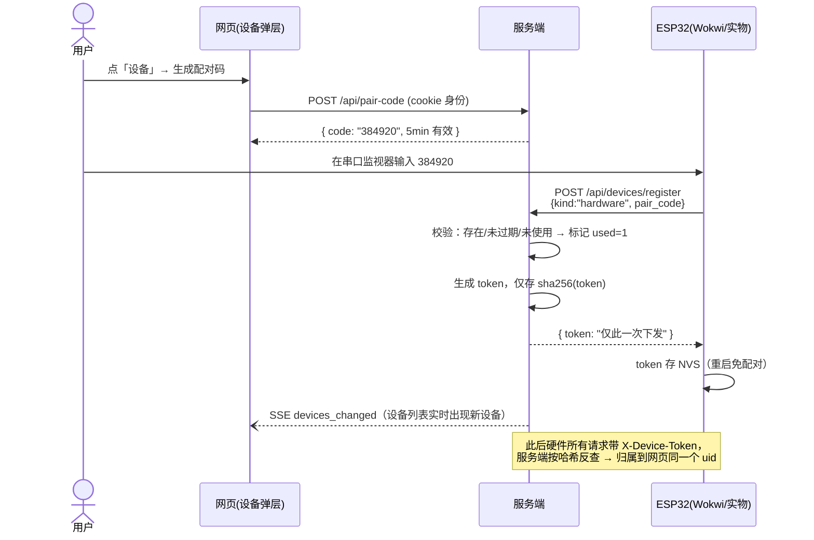
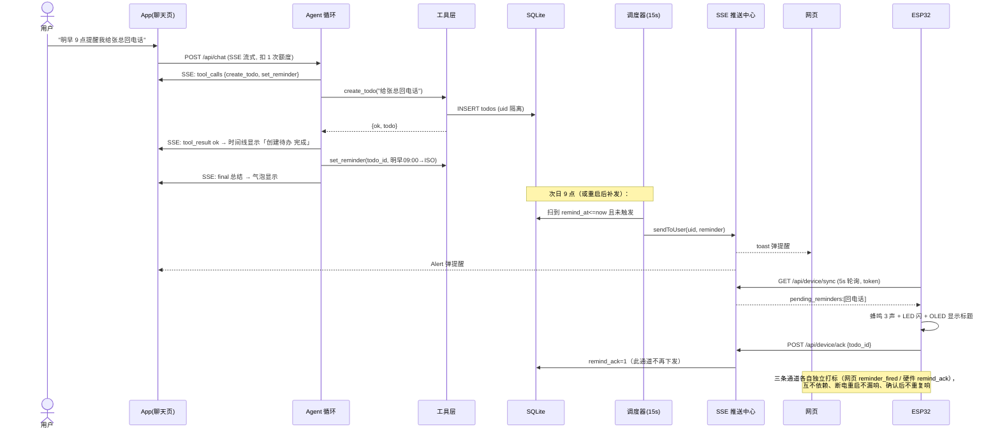
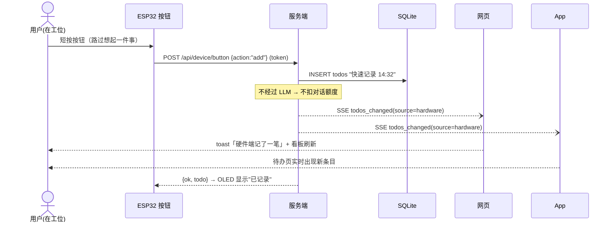

# 多端与硬件联动：网页 · App · ESP32 三端架构

> 一句话：**一个后端，三种入口**。网页、App、硬件通过「配对码 → 设备 token」绑定到同一个用户身份，共享同一份待办、历史与提醒；任何一端产生变化，其余两端实时看到。

## 1. 总体架构

```mermaid
flowchart LR
    subgraph 客户端（三端入口）
        W[网页<br/>HTML/JS 单页<br/>浏览器原生 EventSource]
        A[App<br/>React Native · Expo<br/>XHR-SSE]
        H[硬件<br/>ESP32 · Wokwi 仿真/实物<br/>OLED+按钮+LED+蜂鸣器<br/>HTTP 轮询]
    end

    subgraph 服务端 Express :3016
        ID[身份层<br/>Cookie/指纹 · X-Device-Token<br/>设备表+配对码表]
        Q[额度层<br/>BEGIN IMMEDIATE 事务]
        AG[Agent 循环<br/>ReAct ≤6 轮<br/>DeepSeek function calling]
        T[工具层<br/>create_todo / set_reminder / list_todos<br/>complete_todo / save_fact / query_history]
        S[SSE 推送中心<br/>uid → 多连接广播]
        SC[提醒调度器<br/>15s 扫描到点提醒]
        DEV[设备 API<br/>pair-code / register / devices<br/>device/sync · ack · button]
        DB[(SQLite<br/>users/todos/messages/facts<br/>devices/pair_codes)]
    end

    LLM[DeepSeek API<br/>OpenAI 兼容]

    W -- REST + SSE --> ID
    A -- REST + SSE(token) --> ID
    H -- REST 轮询(token) --> ID
    ID --> Q --> AG
    AG <--> LLM
    AG --> T --> DB
    DEV --> DB
    SC --> DB
    T --> S
    SC --> S
    DEV --> S
    S -- 实时事件流 --> W
    S -- 实时事件流 --> A
```

三端关系本质：

| | 网页 | App（RN/Expo） | 硬件（ESP32） |
| --- | --- | --- | --- |
| 角色 | 主操作台 | 移动入口 | 物理世界的"手和铃铛" |
| 身份 | cookie + 指纹/IP | 设备 token | 设备 token |
| 下行通道 | SSE（EventSource） | SSE（XHR onprogress） | HTTP 轮询 5s + ack |
| 上行能力 | 聊天/完成待办/语音输入 | 聊天/完成待办 | 物理按钮：记一笔/完成 |
| 提醒触达 | toast | Alert 弹窗 | 蜂鸣器+LED+OLED（最不可忽略的通道） |
| 额度 | 扣（走 LLM） | 扣（走 LLM） | **不扣**（按钮不走 LLM） |

设计原则：**硬件不是"另一套系统"，只是同一条 API 上的又一个客户端**——所以三端天然共享数据，不需要任何"同步服务"。

## 2. 关键时序

### 2.1 设备配对：网页生成码 → 硬件/App 绑定（三端同身份的关键）



App 的注册走同一个接口（`kind:"app"`），不带配对码则新建独立身份（多用户隔离）。

### 2.2 全链路：一句话 → 待办 → 提醒 → 三端触达



### 2.3 反向联动：硬件按钮 → 多端实时同步



长按（>1.2s）= `action:"complete"`，完成最早一条 open 待办，同样广播三端。

## 3. 关键取舍

1. **同一身份 = 配对码，而不是各端独立账号**。注册登录能解决但成本高；配对码方案 20 行代码实现"三端绑定"，且配对码一次性 + 5 分钟过期 + token 只存哈希，安全上限够 demo 也能讲清楚生产化路径（换成登录态签发设备 token 即可）。
2. **硬件用 HTTP 轮询而非 MQTT**（对比表见 `hardware/README.md`）：零服务端依赖、纯出站连接天然穿透，5s 延迟对"分钟级提醒"无感；MQTT 是清晰的升级路径，协议语义（sync/ack）不需要变。
3. **提醒可靠性靠幂等标记而非投递时机**：网页通道 `reminder_fired`、硬件通道 `remind_ack` 两条独立状态，调度器重启补发、硬件轮询晚到都不会漏/重。
4. **硬件按钮不计额度**：额度口径 =「1 次成功发起的 Agent 会话（LLM 参与）」。按钮是确定性代码路径，不产生模型调用成本（eval D6 验证）。
5. **App 不引导航库**：三页用 Tab state 切换，Expo 内置能力即可跑（Expo Go 免自定义开发构建）；唯一的"硬骨头" SSE 用 XHR onprogress 跨端可靠实现。

## 4. 运行手册（三端全联通演示）

```bash
npm start                                # ① 服务端 http://127.0.0.1:3016
npx cloudflared tunnel --url http://127.0.0.1:3016   # ② 给 Wokwi 用的公网隧道
cd app-rn && npm install && npx expo start           # ③ App（Expo Go 扫码）
# ④ Wokwi：wokwi.com 新建 ESP32 项目，粘贴 hardware/wokwi/ 三个文件，API_BASE 填隧道地址
```

配对顺序：网页「设备」生成码 → App 首启填码 → 再生成一个码给 ESP32 串口 → 三端互通。

## 5. 自动化证明

```bash
npm run eval:device    # 多端联动 13 项：配对码安全/token 隔离/按钮同步/提醒下发与 ack 幂等/撤销失效/额度口径
npm run eval:quota     # 额度 7 项（回归）
npm run eval:history   # 历史问答 6 项（回归）
```

报告落盘 `data/eval-device.json` 等三份 JSON，全部断言通过才算绿。
